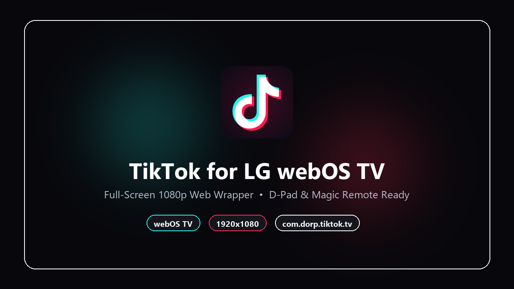

# TikTok for LG webOS TV

<p align="center">
  
</p>

<p align="center">
  
</p>

A clean, TV-optimized **LG webOS** `.ipk` application (`com.dorp.tiktok.tv`) that wraps TikTok (`https://www.tiktok.com`) for full-screen 1080p playback on LG Smart TVs, complete with official branding assets, a dark-mode loading screen, TV remote key handling, and a network fallback screen.

## Features

- **1080p Full-Screen TV Experience**: Configured for `1920x1080` resolution with `#000000` background and custom splash screen.
- **Official Branding Assets**: Launcher icons (`80x80`, `130x130`) and `1920x1080` splash background generated from extracted TikTok APK resources.
- **TV Remote & Magic Remote Support**:
  - `▲` / `▼` D-Pad scrolling for feeds and error-screen navigation
  - `OK` / `Enter` / `Play` / `Pause` playback & action triggers
  - `BACK` (`461`) / `Return` handling via `webOS.platformBack()`
  - Magic Remote pointer hover and focus rings
- **Network Fallback Screen**: Detects offline/unreachable states with a focusable **Retry** and **Exit App** prompt.

## Project Structure

```text
tiktok-webos-tv/
├── appinfo.json          # webOS app manifest (com.dorp.tiktok.tv)
├── index.html            # Loading & error fallback UI
├── style.css             # 1080p dark-mode TV styling
├── app.js                # Connectivity probe, launcher & remote key handler
├── icon.png              # 80x80 webOS launcher icon
├── largeIcon.png         # 130x130 webOS large launcher icon
├── splashBackground.png  # 1920x1080 dark splash screen
├── assets/               # Source branding & README banner assets
└── dist/                 # Packaged .ipk output (generated)
```

## Build & Install

### Prerequisites

- [Node.js](https://nodejs.org/)
- [`@webos-tools/cli`](https://www.npmjs.com/package/@webos-tools/cli):
  ```bash
  npm install -g @webos-tools/cli
  ```
- LG TV with **Developer Mode** enabled and configured via `ares-setup-device`.

### Package to `.ipk`

```bash
ares-package . -o dist -e "README.md" -e ".gitignore" -e "assets/preview-banner.png"
```

This outputs `dist/com.dorp.tiktok.tv_1.0.0_all.ipk`.

### Deploy & Launch on LG TV

```bash
# Verify your configured TV device name
ares-setup-device --list

# Install the IPK (replace 'tv' with your device name)
ares-install -d tv dist/com.dorp.tiktok.tv_1.0.0_all.ipk

# Launch TikTok on the TV
ares-launch -d tv com.dorp.tiktok.tv
```
